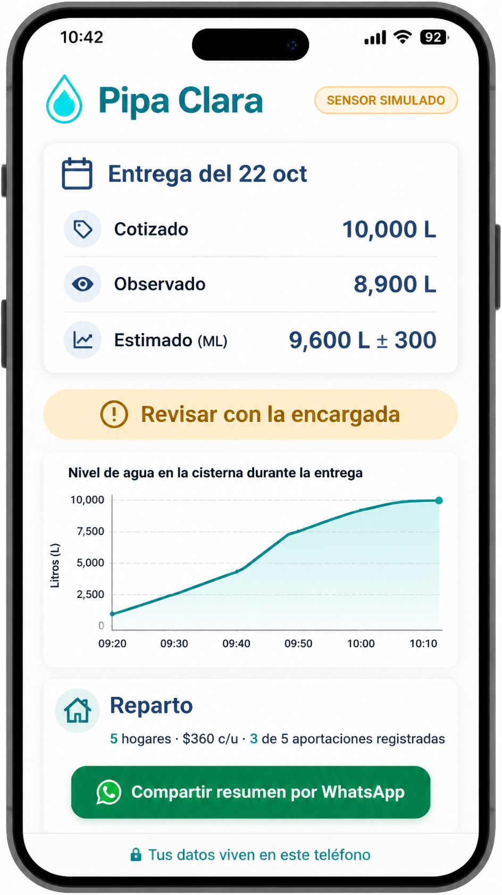
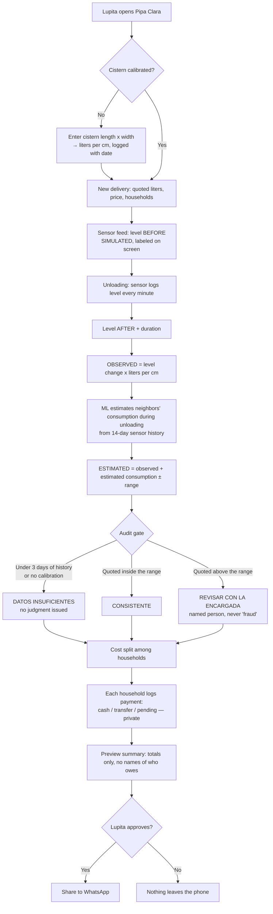
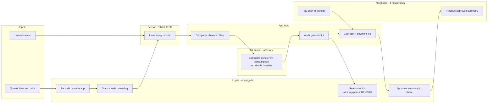
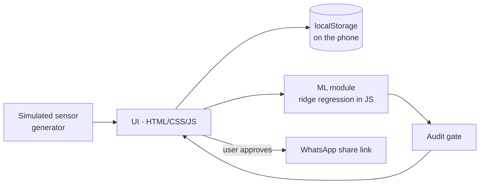

# PACKET — Pipa Clara · Week 11 · Fátima Fortes Ortega (ADVERSARY)

> Business Bending · *When Scarcity Ends — And What We Lose Anyway* · Chapter 10, *Dreaming of Plenitude*
> Team Blueprint primary vacuum: **HOUSEHOLD WATER TOOLS — Pipa entre vecinos**
> My declaration: *challenge confirmation, access and data control; define audit gates* (Conditions 1, 3, 4)

---

## 1. The problem, in my words

In CDMX, many buildings and vecindades share one cistern. When tandeo leaves it empty, neighbors chip in to buy a private pipa (~1,800 MXN for 10,000 L, Profeco reference). Two things go wrong every time:

1. **Nobody can check the volume.** The pipero says "10,000 litros" and everyone pays for 10,000. Nobody knows how much actually went in, because people keep using water *while* it unloads, and nobody measured the level before.
2. **Splitting the cost breaks relationships.** The money is chased in the WhatsApp group, the same person always fronts it, and the "who hasn't paid" message turns into public shaming.

In my Brain Bending I argued the crisis is **who owns the record**. Today the only record of a delivery is the pipero's word. Pipa Clara gives the residents **their own second record**, measured by an instrument the seller doesn't control, and never turns that record into a weapon against a neighbor.

## 2. The exact user

**Lupita, 41, building coordinator (encargada) of a 5-household vecindad in Iztapalapa.** Tandeo leaves the shared cistern empty about once a week in dry season. She is the one who calls the pipa, receives it, fronts the money and chases the other four households on WhatsApp. She uses an Android phone, WhatsApp all day, and no other apps if she can avoid it. She doesn't want to accuse the pipero (she needs him to come back) and she doesn't want to fight with neighbors.

Secondary users: the other 4 households, who only see the summary she chooses to share.

## 3. Success definition

**Before the module closes (Sunday, Oct 25, 2026)**, at a live URL, Lupita can:
1. Calibrate her cistern (dimensions → liters per cm);
2. Record a delivery with the quoted liters and price;
3. See the **simulated** sensor feed of the cistern level before, during and after the unloading;
4. Get **three separate numbers** (quoted, observed, ML-estimated with an uncertainty range) and an **audit-gate verdict** that is never "fraud";
5. Split the cost among households, log cash or transfer payments, and correct entries privately;
6. Share **only a summary she approves** to WhatsApp,

…all without creating an account and without any of her data leaving her phone.

## 4. Mockup (image-generated)

*Image generated with Canva's AI image tool from a written screen description. The final build follows its structure: badge "SENSOR SIMULADO", the three numbers kept separate, a neutral (amber, not red) verdict, the level chart, the cost split and the WhatsApp share, with "Tus datos viven en este teléfono" as the footer.*

*Note: the mockup's chart is illustrative. In the build, the chart and the three numbers are computed from the same sensor data, so they always agree.*

## 5. The flow

### 5a. Flowchart — how one delivery is verified

### 5b. Swimlane — who does what

## 6. Benchmark line

- **The best existing solution on Earth for this is** Bengaluru's *Sanchari Cauvery* (India): GPS-tracked state tankers with an **OTP at delivery**, so "it never arrived" becomes a missing record.
- **Mine differs / localizes by** measuring **volume, not just arrival**, for **private pipas shared among neighbors**, with a record the residents own on their own phone, no app account, no government in the loop, and WhatsApp (not a new app) as the only sharing channel.

## 7. The long view (light charter)

If this slice works, in 3 years Pipa Clara becomes the **resident-held water ledger** for shared cisterns: a cheap real ultrasonic sensor (~300 MXN) replaces the simulation, and a building's history shows how often tandeo fails and how much it really pays for water. With residents' explicit consent, anonymized colonia-level totals could become the independent evidence my Brain Bending argued for: the second record that feeds a **public-pipa audit**, which the Blueprint keeps as a separately gated later extension. The load-bearing wall I keep deliberate from day one: **the record belongs to the household, and the app never scores or ranks people.**

## 8. Scope cut — what I'm NOT building

- ❌ No real hardware sensor (simulated feed, labeled on every screen).
- ❌ No user accounts, no server database, no data leaving the phone (Condition 1).
- ❌ No supplier directory, no pipero ratings, no marketplace of pipas (Condition 4 + Kill D from my brief).
- ❌ No payment processing: the app **logs** money, never holds it (Condition 4).
- ❌ No arrival forecast for the next pipa (no history → no promise; Condition 6).
- ❌ No municipal integration or public-pipa audit (Blueprint: later, gated extension).
- ❌ No "fraud" label, no debtor lists, no reputation scores (Condition 2, shadow clause).

## 9. Architecture + stack

**Local-first static web app.** Everything runs in the browser; data lives in the phone's `localStorage`. The only thing that ever leaves the device is a text summary the user explicitly approves and sends through WhatsApp.

| Layer | Choice | Why |
|---|---|---|
| Frontend | Plain HTML + CSS + JavaScript (ES modules), no build step | Free, fast, works on cheap Android phones |
| Hosting | GitHub Pages (free, HTTPS) | Live URL, deploys on every push |
| Storage | Browser `localStorage` (wrapped in try/catch) | Condition 1: data stays on the device; no personal data on any server |
| **IoT / sensing** | Simulated ultrasonic level sensor: 14 days of readings every 15 min + per-minute feed during unloading, with noise; 3 scenarios (full delivery, short delivery, noisy sensor) | Stack floor allows simulated feeds if labeled |
| **ML** | Ridge regression (hour-of-day + weekend features) trained in the browser on the sensor history to predict water consumption per minute; evaluated on a 2-day hold-out vs. a baseline (overall mean rate) | Condition 6: advisory, checked against a simple baseline |
| **Marketplace logic** | Cost-split ledger: equal or custom shares, payment method (cash / transfer), private correction | Condition 2 + 4 |
| Sharing | `https://wa.me/?text=` link with an approved summary | No integration, no backend |
| Tests | Plain JS test page (`tests.html`) for the math, ML and gate | Free, runs in any browser |

**Security floor:**
| Check | How Pipa Clara meets it |
|---|---|
| No secrets in repo | No API keys needed at all |
| Auth for personal data | No personal data is stored on any server; everything stays on the user's device, so there is no open door to protect |
| Row Level Security | Not applicable: no database |
| Input validation | Every form has type checks and min/max/length limits; text is escaped before rendering and before going into the WhatsApp summary |
| No real personal data | Demo data is invented and labeled "DATOS DE EJEMPLO" |

## 10. Blueprint conditions → design

| # | Condition | How this slice honors it |
|---|---|---|
| 1 | Residents control sharing | Data never leaves the phone; summary preview + explicit approval before WhatsApp; raw readings never shared |
| 2 | **SHADOW CLAUSE** | No scores, no debtor list (summary shows "3 of 5 contributions logged", never names); cash accepted; any household entry can be privately corrected |
| 3 | Separate quoted / observed / estimated | Three numbers always shown separately, with uncertainty range; calibration logged with date; concurrent consumption estimated and shown; verdict never says "fraud" |
| 4 | Named person handles discrepancies | Verdict "Revisar con [name]" uses the coordinator's name set in Settings; no supplier directory; money logged, never held |
| 5 | Measure total cost | Settings records equipment cost (real sensor estimate) and coordinator minutes per delivery; summary shows cost per household including them |
| 6 | Label simulated feeds / ML | "SENSOR SIMULADO" and "Estimación ML (orientativa)" badges on screen; ML compared to baseline with error shown; no arrival forecast |

## 11. Test plan

**Mechanical pass (tests.html + manual):**
1. Calibration: 2.0 m × 1.5 m → 30 L/cm. Rejects 0, negatives, text, values > 10 m.
2. Observed liters: level 20 cm → 340 cm with 30 L/cm = 9,600 L.
3. ML: model error (MAE) on hold-out is reported and compared against the baseline; the app labels which one is better.
4. Gate: under 3 days of history → "Datos insuficientes"; quoted inside range → "Consistente"; quoted above range → "Revisar con …".
5. Scenarios: "full delivery" → Consistente; "short delivery" → Revisar; "noisy sensor" → wider range.
6. Cost split: 1,800 MXN / 5 = 360 each; custom shares must add up to the total.
7. Summary text contains no household names next to "pending" and no raw readings.
8. Input with `<script>` in a name is shown as text, not executed.
9. Works with localStorage blocked (private mode): app still works for the session and shows a notice.
10. Mobile width 360 px: no horizontal scroll.

**Persona pass:** synthetic user "Doña Lupita" (see PERSONA log) walks every screen from screenshots; every confusion logged; the worst one fixed and redeployed.
